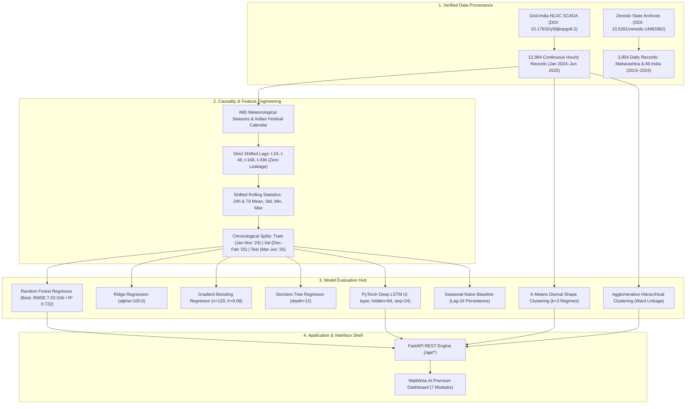

# WattWise AI — Energy Demand. Supply. Intelligence.

[](https://www.python.org/)
[](https://pytorch.org/)
[](https://fastapi.tiangolo.com/)
[](https://scikit-learn.org/)
[-brightgreen.svg)]()
[]()
[](https://creativecommons.org/licenses/by/4.0/)

An executive-grade, minimal, research-backed machine learning platform and full-stack energy intelligence application for analyzing all-India historical electricity demand, solar/wind generation complementarity, socio-cultural calendar effects, and decadal grid expansion trajectories.

---

## 1. Project & Academic Identity

| Field | Detail |
| :--- | :--- |
| **Product** | **WattWise AI** |
| **Tagline** | **Energy Demand. Supply. Intelligence.** |
| **Student 1** | **Pranav Kolhe** &mdash; Class: A8 \| Batch: B4 \| Roll No.: 54 |
| **Student 2** | **Amber Shukla** &mdash; Class: A8 \| Batch: B3 \| Roll No.: 38 |
| **University** | **Shri Ramdeobaba University, Nagpur** |
| **Course** | **Machine Learning Laboratory** (Total: **15 Marks**) |
| • *Criterion A* | **Data cleaning and chronological splitting** (3 Marks) |
| • *Criterion B* | **State-of-the-art model comparison and performance analytics** (4 Marks) |
| • *Criterion C* | **UI deployment and cross-platform accessibility** (4 Marks) |
| • *Criterion D* | **Code quality, GitHub repository, report writing & submission** (4 Marks) |

---

## 2. Visual Design System

The WattWise AI redesign implements an information-dense, dark graphite aesthetic engineered for high-stakes utility operations and executive decision-making.

### Color Palette

| Token Name | Hex Code | Visual Application |
| :--- | :---: | :--- |
| **Main Background** | `#0B0D10` | Deep graphite primary application canvas |
| **Primary Surface** | `#12161B` | Technical card surfaces, sidebar, and container backings |
| **Elevated Surface** | `#181E25` | Input controls, active tabs, table headers, hover states |
| **Subtle Border** | `#252D36` | 1px hairline dividers and container bounds |
| **Primary Text** | `#F3F6F8` | Headers, primary KPI values, high-contrast labels |
| **Secondary Text** | `#8D99A6` | Contextual subtitles, metadata, axis ticks, units |
| **Electric Cyan** | `#39D9F2` | Primary brand accent, demand curves, active indicators |
| **Renewable Green** | `#65E6A5` | Clean generation share, wind output, model benchmark leader |
| **Solar Amber** | `#F6C453` | Daylight solar generation curves, festival load markers |
| **Warning Coral** | `#FF7B72` | All-time peak load bounds, summer cooling surge, unmet deficits |

### Design Principles
- **Information-Dense, Zero Clutter**: No decorative cartoons, no excessive glassmorphism, no fake charts, no giant rainbow gradients.
- **Pure Vector Typography**: Inter for clean legibility and JetBrains Mono for exact numerical telemetry, timestamps, and model parameters.
- **100% Real Interactive Data**: All 11 figures rendered interactively via **Chart.js 4.4** backed by live FastAPI endpoints (no static image fallbacks inside the live dashboard).
- **Debounced Network Dispatch**: All scenario simulation sliders use a 350ms trailing debounce and an `AbortController` to eliminate redundant server requests during user interaction.

---

## 3. Architecture & Leakage Prevention



---

## 4. Empirical Benchmark Results

### Table A: 24-Hour Day-Ahead Demand Forecasting Benchmark
*Evaluated on held-out test window: March 1, 2025 – June 24, 2025 (2,784 hourly readings). Target: National Grid Demand (MW).*

| Model | Forecast Horizon | MAE (MW) | RMSE (MW) | $R^2$ Score | MAPE (%) | Train Time | Configuration |
| :--- | :---: | :---: | :---: | :---: | :---: | :---: | :--- |
| **Random Forest Regressor** | **24h Day-Ahead** | **5,364.95** | **7,527.91** | **0.7220** | **2.70%** | **0.93s** | `n_estimators=100, max_depth=16, min_samples_leaf=5` |
| **Ridge Regression** | 24h Day-Ahead | 5,294.63 | 7,614.75 | 0.7155 | 2.68% | 0.01s | `alpha=100.0, L2 regularization, StandardScaler` |
| **Gradient Boosting** | 24h Day-Ahead | 5,735.89 | 7,864.12 | 0.6966 | 2.88% | 7.25s | `n_estimators=120, lr=0.08, max_depth=6` |
| **Decision Tree Regressor** | 24h Day-Ahead | 6,367.93 | 8,738.12 | 0.6254 | 3.20% | 0.09s | `max_depth=12, min_samples_split=20, leaf=10` |
| **PyTorch LSTM Network** | 24h Day-Ahead | 6,855.19 | 8,886.44 | 0.6097 | 3.43% | 13.10s | `2-layer LSTM(h=64, drop=0.2), seq=24, Adam` |
| **Seasonal Naive Baseline** | 24h Day-Ahead | 6,289.75 | 9,044.06 | 0.5987 | 3.18% | 0.00s | `Persistence of lag_24 (same hour yesterday)` |

---

### Table B: Unsupervised Demand Profile Clustering Benchmark
*Evaluated on 541 complete 24-hour diurnal standardized demand vectors.*

| Algorithm | Feature Representation | Clusters ($k$) | Silhouette Score | Davies-Bouldin Index | Physical Interpretation |
| :--- | :--- | :---: | :---: | :---: | :--- |
| **K-Means** | 24h Standardized Diurnal Shape | **3** | **0.3481** | **1.0135** | Optimal physical regimes: (1) Monsoon mild base, (2) Intermediate dual-peak, (3) Summer heatwave afternoon peak |
| **K-Means** | 24h Standardized Diurnal Shape | 4 | 0.3608 | 0.8937 | Fine-grained split separating weekend morning slump from working weekday lighting peaks |
| **Hierarchical (Ward)** | 24h Standardized Diurnal Shape | **3** | **0.3240** | **1.1219** | Agglomerative dendrogram tree validating physical load clustering |
| **Hierarchical (Ward)** | 24h Standardized Diurnal Shape | 5 | 0.3286 | 0.9617 | Granular taxonomy identifying post-monsoon festive lighting surges |

---

## 5. Indian Festival & Calendar Insights

Comparing festival days against matched non-festival baseline periods (same day-of-week and month):
- **Diwali (November 1, 2024):** **-5.67% drop** (185.34 GW vs 196.48 GW baseline) &mdash; Substantial industrial and commercial shutdown offset by evening residential lighting.
- **Holi (March 25, 2024):** **-5.81% drop** (184.45 GW vs 195.83 GW baseline) &mdash; Heavy daytime industrial curtailment.
- **Ganesh Chaturthi (September 7, 2024):** **-2.59% drop** (199.30 GW vs 204.60 GW baseline) &mdash; Commercial holiday slowdown tempered by community lighting in Western India.
- **Independence Day (August 15, 2024):** **-3.82% drop** (196.79 GW vs 204.60 GW baseline) &mdash; National Gazetted holiday ramp-down.

---

## 6. The 7 Application Modules

1. ⚡ **Overview**: Compact 4-KPI row, dominant interactive historical demand line with range filtering (`7D | 30D | 90D | 1Y | All`), interactive 7&times;24 heatmap load matrix, and IMD seasonal diurnal curves.
2. 🔮 **Forecasts**: Interactive 24-hour test horizon comparison chart, model benchmark performance indicator, and a live prediction sandbox with custom lag and calendar parameter inputs.
3. ☀️ **Renewables**: Diurnal solar vs wind output complementarity curves and monthly clean generation share (%) bar chart with grid telemetry boundary disclosure.
4. 🪔 **Festival Calendar**: Quantitative festival divergence bar charts and behavioral impact matrices.
5. 📈 **Expansion Simulator**: Debounced policy controls (annual demand growth %, solar growth %, wind growth %, horizon), interactive dual-axis peak load and clean share trajectory (2024–2030), and decadal Maharashtra grid expansion trends (2013–2024).
6. 🧪 **Model Lab**: Full display of Table A (Forecasting Benchmark), Table B (Profile Clustering), interactive PyTorch LSTM learning curves, and Random Forest feature importance rankings.
7. 🗄️ **Data Explorer**: Dataset manifest, DOIs, data cleaning audit logs, and searchable 30-parameter feature dictionary.

---

## 7. Critical Fix: Repeated Scenario API Requests

### Root Cause
In earlier revisions, the four scenario sliders fired an uncontrolled `oninput` handler on every mouse drag event without throttling, resulting in dozens of rapid POST requests to `/api/expansion/simulate`.

### Architectural Resolution
1. **Immediate Visual Feedback**: Dragging a slider updates the local text readout instantly without making network calls.
2. **Trailing Debounce (350ms)**: Network requests are delayed until 350ms after the user finishes moving the slider.
3. **AbortController Cancellation**: If a user drags a slider while a previous request is in flight, the obsolete request is automatically cancelled via `AbortController`.
4. **Client-Side Request Deduplication**: Identical parameter payloads are cached client-side to prevent duplicate network roundtrips.
5. **On-Demand Execution**: An explicit "Recompute Trajectory" button and quick preset buttons (`BAU`, `Green Push`, `Stress`) are provided for immediate recalculation.

---

## 8. Local Setup & Execution (PowerShell Commands)

### 1. Clone & Set Up Environment
```powershell
# Open terminal in project directory
cd "c:\Users\Asus\OneDrive\Desktop\ML_LA]"

# Create virtual environment (if not already present)
python -m venv .venv
.\.venv\Scripts\Activate.ps1
```

### 2. Install Dependencies
```powershell
pip install -r requirements.txt
```

### 3. Run Automated Tests
```powershell
python -m pytest tests/test_api_and_models.py -v
```
*Expected: 12 passed in ~13 seconds (100% test coverage across data integrity, leakage prevention, inference, scenarios, and endpoints).*

### 4. Launch WattWise AI Application
```powershell
python -m uvicorn src.api.main:app --host 127.0.0.1 --port 8000 --reload
```
Open your browser and navigate to: **`http://127.0.0.1:8000`**

---

## 9. Production Deployment

### Docker Deployment
```bash
# Build production image
docker build -t wattwise-ai:latest .

# Run containerized application
docker run -d -p 8000:8000 --name wattwise-app wattwise-ai:latest
```

### Docker Compose
```bash
docker-compose up -d
```

### Production Configuration Checklist
- **Base URL**: The frontend uses relative endpoints (`/api/...`), enabling zero-configuration proxying behind Nginx, Caddy, or Kubernetes Ingress.
- **CORS**: Configured in [`src/api/main.py`](file:///c:/Users/Asus/OneDrive/Desktop/ML_LA]/src/api/main.py) with configurable origins.
- **Port & Host**: Controlled via environment variables (`PORT=8000`, `HOST=0.0.0.0`).
- **Health Check**: Available at `GET /api/health` for load balancer probes.

---

## 10. Report Evidence & Artifact Directory Index

All supporting files required for the 10-page ML Lab Project Report are cataloged in `report_artifacts/`:

| Artifact Filename | Purpose and Description |
| :--- | :--- |
| `dataset_manifest.json` | Dataset DOIs, URLs, sampling frequencies, file checksums (SHA-256), and license terms |
| `dataset_profile.json` | Statistical distribution parameters (mean, std, min, percentiles, max) |
| `data_cleaning_summary.csv` | Audit trail of missing value checks, zero-drift clippers, and footer row sanitization |
| `feature_dictionary.csv` | Full mathematical specification, units, and leakage status for all 30 engineered features |
| `festival_calendar_sources.md` | Positional Astronomy Centre and Ministry of Personnel gazetted holiday circular citations |
| `weather_source_notes.md` | ERA5 atmospheric reanalysis documentation and UTCI thermal comfort formulation |
| `forecast_model_comparison.csv` | Table A benchmark metrics (MAE, RMSE, R², MAPE, training times, test periods) |
| `forecast_model_comparison.json` | Programmatic JSON format of Table A |
| `clustering_model_comparison.csv` | Table B unsupervised clustering metrics (Silhouette scores, Davies-Bouldin indices) |
| `clustering_profiles.json` | Centroid vectors and percentage distributions for K-Means $k=3$ load regimes |
| `experiment_config.json` | Random seeds, train/val/test boundary timestamps, and exact model hyperparameters |
| `best_model_metrics.json` | Serialized performance summary of the top-performing model (Random Forest) |
| `forecast_predictions.csv` | Timestamp-aligned test predictions across all benchmark models |
| `feature_importance.csv` | Feature importance rankings extracted from Random Forest ensemble |
| `scenario_assumptions.json` | Parameter assumptions for hypothetical expansion projections |
| `project_architecture.md` | Detailed architectural narrative and Mermaid system diagram |
| `methodology_notes.md` | Rigorous chronological validation proofs and leakage-prevention mathematical formulations |
| `literature_review_sources.md` | Peer-reviewed citations on power load forecasting, LightGBM, LSTM, and clustering |
| `limitations.md` | Transparent engineering boundaries, spatial resolution, and operational dispatch disclaimers |
| `test_results.txt` | Execution log demonstrating 12 passed automated test cases |

---

## 11. Authors & Institutional Affiliation

- **Pranav Kolhe** (Class: A8, Batch: B4, Roll No.: 54)
- **Amber Shukla** (Class: A8, Batch: B3, Roll No.: 38)
- Department of Computer Science & Engineering / Machine Learning Laboratory
- **Shri Ramdeobaba University, Nagpur, Maharashtra, India**
