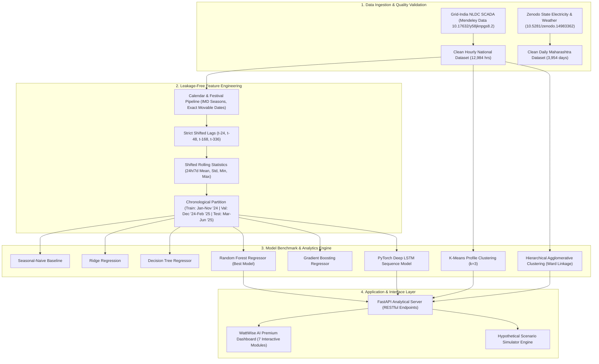

# WattWise AI — System Architecture & Implementation Design
**Academic Course:** Machine Learning Laboratory | Shri Ramdeobaba University, Nagpur
**Students:** Pranav Kolhe (Class: A8, Batch: B4, Roll: 54) & Amber Shukla (Class: A8, Batch: B3, Roll: 38)

## Architectural Highlights
1. **Strict Decoupling**: Data engineering, model training, analytical evaluation, and RESTful API endpoints reside in isolated Python packages (`src.data`, `src.models`, `src.analysis`, `src.api`).
2. **Deterministic Reproducibility**: Fixed random seeds (`seed=42`), persistent scaler artifacts (`scaler.joblib`, `y_scaler.joblib`), and serialized weights (`best_lstm.pt`).
3. **Multi-Scale Temporal Analytics**:
   - High-frequency 1-hour resolution for operational load dispatch & day-ahead forecasting.
   - Low-frequency multi-year daily resolution for state infrastructure expansion and peak unmet deficit tracking.
